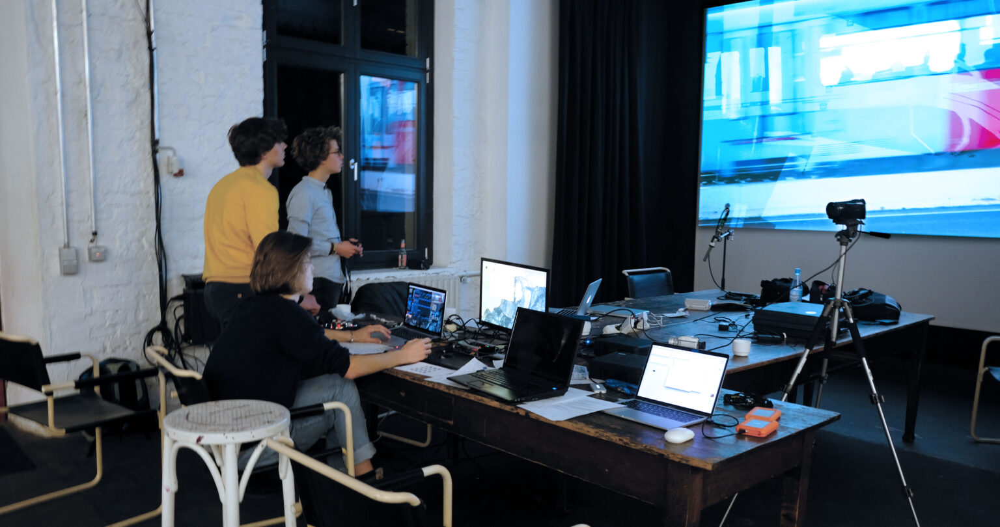
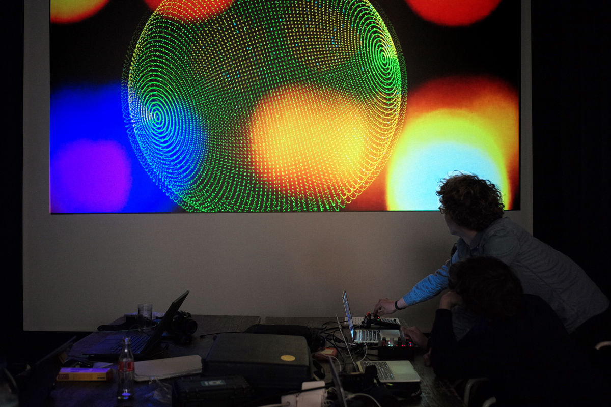

## Schönes Wochenende Festival

*„Urban Loops and Drones“* lässt aus der Unruhe der Stadt, aus ihren täglichen Geräuschen und Klängen eine musikalisch-visuelle Performance werden.
Junge Musiker und Bildkomponisten entwickeln in mehreren Projekttreffen in der Filmwerkstatt eine visuelle Live-Show, die sich auf 9 klassischen Musikkompositionen von SchülerInnen der Musikschule Düsseldorf bezieht. Die live bearbeitet und gemixten Bildwelten eröffnen neue Ton-Bild-Ebenen.

- <a href="https://www.tonhalle.de/presse/2017-12-urban-loops-and-drones" target="_blank">Tonhalle Düsseldorf</a>
- <a href="https://www.filmwerkstatt-duesseldorf.de/junge-filmwerkstatt-archiv/#~URBAN%20LOOPS%20AND%20DRONES:~:text=Thema%20Konsum%20auseinander.-,URBAN%20LOOPS%20AND%20DRONES,-KOOPERATIONSPROJEKT%20MIT%20DER" target="_blank">Junge Filmwerkstatt Archiv</a>

