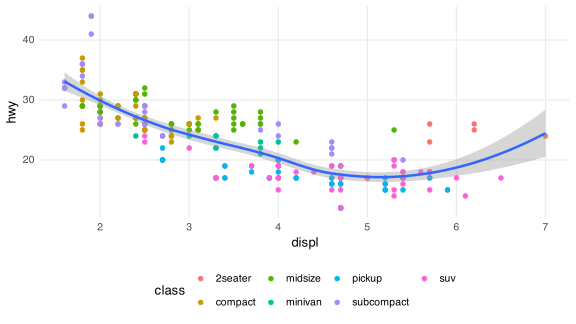
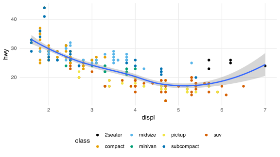

Three types of palettes:

1.  discriminate

2.  qualitative

3.  smooth

### The {ggplot2} default colors

``` r
ggplot(mpg, aes(displ, hwy)) +
  geom_point(aes(color = class)) +
  geom_smooth()
```



-\> not color blindness friendly

### Quick switch to `Okabe-Ito`

``` r
ggplot(mpg, aes(displ, hwy)) +
  geom_point(aes(color = class)) +
  geom_smooth() +
  scale_colour_manual(values = palette.colors(palette = "Okabe-Ito"))
```



The Nature standard in academic publishing. See @wong2011PointsView.
